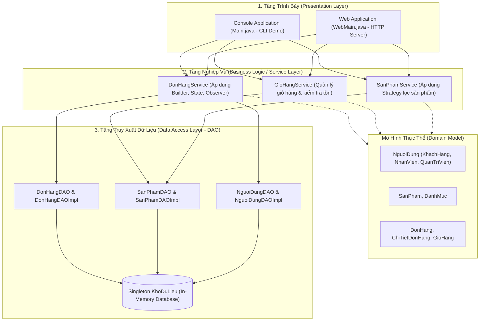

# TechNest — Hệ Thống Quản Lý & Bán Thiết Bị Điện Tử
> **Đồ án Báo cáo Giữa kỳ môn Mẫu Thiết Kế (Design Patterns)**  
> Ứng dụng thực tế các Mẫu Thiết Kế Hướng Đối Tượng (GoF) và Kiến Trúc 3 Tầng trong Hệ Thống Thương Mại Điện Tử Thiết Bị Điện Tử.

[](https://www.oracle.com/java/)
[](https://en.wikipedia.org/wiki/Software_design_pattern)
[](#2-kiến-trúc-hệ-thống)
[](#4-hướng-dẫn-cài-đặt-và-khởi-chạy)
[](#6-kiểm-thử-tự-động-automated-tests)

---

## 1. Giới Thiệu Dự Án

**TechNest** là ứng dụng mô phỏng hệ thống bán lẻ và quản lý thiết bị điện tử trực tuyến, được xây dựng hoàn toàn bằng **Java thuần (Pure Java SE)**, không phụ thuộc vào bất kỳ thư viện ngoài (Third-party library), framework nặng (Spring/Hibernate) hay hệ quản trị CSDL cồng kềnh nào.

### Điểm nổi bật:
- **Tập trung vào Mẫu Thiết Kế (Design Patterns)**: Áp dụng trực tiếp và đúng ngữ cảnh 6 mẫu thiết kế kinh điển của GoF (Gang of Four) để giải quyết các bài toán thực tế: tạo đối tượng, lọc dữ liệu động, kiểm soát vòng đời đơn hàng và thông báo trạng thái.
- **Hai chế độ trình diễn song song**:
  1. **Web GUI (Giao diện Web trực quan)**: Tích hợp máy chủ HTTP gọn nhẹ (`com.sun.net.httpserver`), giao diện HTML5/CSS hiện đại, hỗ trợ đa phiên (Session), chống CSRF, phân quyền 3 vai trò (Khách hàng, Nhân viên, Admin).
  2. **Console CLI Demo**: Kịch bản chạy tuần tự trên Terminal minh họa từng bước áp dụng mẫu thiết kế từ A đến Z, rất thuận tiện khi thuyết trình code với giảng viên.
- **Độc lập và Khởi chạy tức thì**: Đóng gói sẵn file thực thi `TechNest.jar`, chỉ cần máy có JDK/JRE 17+ là chạy ngay với 1 cú click chuột (`run.bat`).

---

## 2. Kiến Trúc Hệ Thống

Hệ thống được thiết kế theo **Kiến trúc 3 Tầng (3-Tier Architecture)** kết hợp mẫu **DAO (Data Access Object)**:



---

## 3. Phân Tích Chi Tiết Các Mẫu Thiết Kế (GoF Patterns)

| STT | Mẫu Thiết Kế | Phân Loại | Vị Trí Trong Mã Nguồn | Vai Trò & Mục Đích Trong Hệ Thống |
|:---:|:---|:---:|:---|:---|
| 1 | **Singleton** | Khởi tạo *(Creational)* | `singleton/KhoDuLieu.java` | Đảm bảo duy nhất một thực thể bộ nhớ dùng chung, mô phỏng CSDL trung tâm cho các DAO. |
| 2 | **Factory Method** *(Simple Factory)* | Khởi tạo *(Creational)* | `factory/NguoiDungFactory.java` | Che giấu logic tạo phân lớp người dùng (`KhachHang`, `NhanVien`, `QuanTriVien`) dựa trên `VaiTro`. |
| 3 | **Builder** | Khởi tạo *(Creational)* | `builder/DonHangBuilder.java` | Xây dựng từng bước đối tượng `DonHang` phức tạp, kiểm tra tồn kho, trừ kho và gán các bộ lắng nghe. |
| 4 | **Strategy** | Hành vi *(Behavioral)* | `strategy/*.java` | Đóng gói linh hoạt các thuật toán/tiêu chí lọc sản phẩm (danh mục, khoảng giá, từ khóa), dễ kết hợp. |
| 5 | **State** | Hành vi *(Behavioral)* | `state/*.java` | Quản lý vòng đời trạng thái của đơn hàng (`ChoXacNhan`, `DaXacNhan`, `DangGiao`, `HoanTat`, `DaHuy`), chặn chuyển trạng thái sai. |
| 6 | **Observer** | Hành vi *(Behavioral)* | `observer/*.java` | Tự động bắn thông báo cho khách hàng ngay khi đơn hàng có sự thay đổi về trạng thái. |

---

### 3.1. Mẫu Singleton (`singleton/KhoDuLieu.java`)
- **Vấn đề**: Trong đồ án không dùng RDBMS ngoài, hệ thống cần một nơi lưu trữ dữ liệu tập trung (`Map<Integer, ...>`) cho toàn bộ ứng dụng. Nếu mỗi DAO tự tạo một kho riêng thì dữ liệu sẽ bị phân mảnh và sai lệch.
- **Giải pháp**:
  - `constructor` đặt `private` để ngăn khởi tạo từ bên ngoài bằng `new`.
  - Biến tĩnh `private static KhoDuLieu instance`.
  - Phương thức truy cập toàn cục `public static synchronized KhoDuLieu getInstance()` bảo đảm Thread-safe khi khởi tạo.
- **Lợi ích**: Tương tự một kết nối Database Connection Pool duy nhất được chia sẻ giữa các DAO.

---

### 3.2. Mẫu Factory Method / Simple Factory (`factory/NguoiDungFactory.java`)
- **Vấn đề**: Người dùng trong hệ thống có nhiều loại với hành vi và quyền hạn khác nhau (`KhachHang`, `NhanVien`, `QuanTriVien`). Nếu khởi tạo trực tiếp bằng `new` rải rác ở khắp các Controller/Service, code sẽ bị phụ thuộc chặt (tight coupling) và lặp đi lặp lại mệnh đề `switch/case`.
- **Giải pháp**: Lớp `NguoiDungFactory` đóng gói toàn bộ logic khởi tạo. Tầng gọi chỉ cần truyền enum `VaiTro` và các thông tin cá nhân.
- **Lưu ý học thuật khi vấn đáp**: Trong mã nguồn, lớp hiện thực dưới dạng **Static Factory Method (Simple Factory Idiom)**. Khi mở rộng sang cấu trúc Factory Method GoF kinh điển, ta có thể tạo `NguoiDungCreator` trừu tượng và các lớp con `KhachHangCreator`, `NhanVienCreator` tương ứng.

---

### 3.3. Mẫu Builder (`builder/DonHangBuilder.java`)
- **Vấn đề**: Một đơn hàng (`DonHang`) là một đối tượng phức hợp, chứa thông tin khách hàng, địa chỉ nhận, danh sách `ChiTietDonHang`, danh sách observer, trạng thái ban đầu và đơn giá sản phẩm cố định tại thời điểm mua. Quá trình tạo đơn đòi hỏi phải kiểm tra tồn kho, trừ tồn kho và liên kết dữ liệu theo đúng thứ tự.
- **Giải pháp**: Sử dụng `DonHangBuilder` theo cơ chế Method Chaining:
  ```java
  DonHang donHang = new DonHangBuilder(maDonHang, khachHang.getMaNguoiDung(), diaChi)
          .tuGioHang(gioHang)
          .dangKyQuanSat(new ThongBaoKhachHang())
          .xayDung();
  ```
- **Lợi ích**: Tách rời quy trình xây dựng phức tạp ra khỏi đối tượng dữ liệu `DonHang`, đảm bảo đơn hàng không bao giờ được tạo ra ở trạng thái thiếu dữ liệu hay vi phạm nghiệp vụ tồn kho.

---

### 3.4. Mẫu Strategy (`strategy/`)
- **Vấn đề**: Trang bán hàng cần tìm kiếm theo nhiều tiêu chí: theo danh mục, theo khoảng giá, theo từ khóa hoặc kết hợp tất cả các tiêu chí trên. Nếu viết lồng các khối `if/else`, hàm tìm kiếm sẽ phình to và vi phạm nguyên lý **Open/Closed Principle (OCP)**.
- **Giải pháp**:
  - Định nghĩa giao diện chung: `DieuKienLoc` với phương thức `boolean thoaDieuKien(SanPham sp)`.
  - Các Concrete Strategy: `LocTheoDanhMuc`, `LocTheoKhoangGia`, `LocTheoTuKhoa`.
  - Tầng dịch vụ `SanPhamService` chỉ cần nhận vào một danh sách `List<DieuKienLoc>` và duyệt qua từng sản phẩm.
- **Lợi ích**: Khi cần bổ sung tiêu chí mới (ví dụ: Lọc theo đánh giá sao, Lọc theo thương hiệu), chỉ cần tạo thêm lớp mới cài đặt `DieuKienLoc` mà không cần sửa đổi bất kỳ dòng code nào trong `SanPhamService`.

---

### 3.5. Mẫu State (`state/`)
- **Vấn đề**: Đơn hàng có vòng đời gồm 5 trạng thái nghiêm ngặt. Tại mỗi trạng thái, chỉ một số thao tác nhất định được phép thực hiện (ví dụ: chỉ được hủy khi "Chờ xác nhận", không được xác nhận đơn khi đã "Hoàn tất"). Nếu dùng biến cờ `status` kết hợp `switch-case` khắp nơi, code sẽ rất dễ lỗi logic và khó bảo trì.
- **Sơ đồ chuyển trạng thái (State Diagram)**:
  ```mermaid
  stateDiagram-v2
      [*] --> ChoXacNhan : Khách đặt hàng
      ChoXacNhan --> DaXacNhan : Nhân viên xác nhận
      ChoXacNhan --> DaHuy : Khách / NV hủy (Hoàn trả kho)
      DaXacNhan --> DangGiao : Nhân viên giao hàng
      DaXacNhan --> DaHuy : NV hủy (Hoàn trả kho)
      DangGiao --> HoanTat : Giao thành công
      HoanTat --> [*]
      DaHuy --> [*]
  ```
- **Giải pháp**:
  - Interface `TrangThaiDonHang` định nghĩa các hành động: `xacNhan()`, `giao()`, `hoanTat()`, `huy()` với cài đặt mặc định ném ra `IllegalStateException`.
  - 5 lớp trạng thái cụ thể: `ChoXacNhan`, `DaXacNhan`, `DangGiao`, `HoanTat`, `DaHuy` chỉ ghi đè (override) các hành động hợp lệ đối với trạng thái đó.
- **Lợi ích**: Biến đổi hành vi của đơn hàng linh hoạt khi trạng thái nội tại thay đổi; đóng gói logic của từng trạng thái vào đúng lớp của nó.

---

### 3.6. Mẫu Observer (`observer/`)
- **Vấn đề**: Khi đơn hàng chuyển trạng thái (Xác nhận, Giao hàng, Hoàn tất, Hủy), hệ thống cần thông báo ngay lập tức cho Khách hàng (qua SMS, Email, Thông báo đẩy). Ta không muốn gắn cứng code gửi thông báo vào bên trong các lớp xử lý nghiệp vụ đơn hàng.
- **Giải pháp**:
  - `Subject`: `DonHang` quản lý danh sách `List<NguoiQuanSatDonHang>`.
  - `Observer`: Interface `NguoiQuanSatDonHang` với phương thức `capNhat(DonHang donHang)`.
  - `Concrete Observer`: `ThongBaoKhachHang`.
  - Khi phương thức `DonHang.setTrangThaiHienTai()` được gọi, nó sẽ tự động kích hoạt `thongBaoQuanSat()` để thông báo đến toàn bộ các observer đã đăng ký.
- **Lợi ích**: Giảm thiểu sự phụ thuộc (Loose Coupling). Sau này nếu muốn gửi Email thật, ta chỉ việc bổ sung `ThongBaoEmail implements NguoiQuanSatDonHang` mà không cần thay đổi `DonHang`.

---

## 4. Hướng Dẫn Cài Đặt và Khởi Chạy

### Yêu Cầu Môi Trường
- **Hệ điều hành**: Windows, macOS, hoặc Linux.
- **Java**: Đã cài đặt **JDK / JRE 17 trở lên** (kiểm tra bằng lệnh `java -version`).

---

### Cách 1: Khởi Chạy Giao Diện Web (Khuyên dùng khi báo cáo)

#### Trên Windows:
Nhấp đúp chuột vào file:
```cmd
run.bat
```
*(Hoặc chạy lệnh `CHAY_GIAO_DIEN.cmd`)*

#### Qua Terminal (Windows / macOS / Linux):
```bash
java -Dfile.encoding=UTF-8 -jar TechNest.jar
```
*Trường hợp cổng 8080 đang bị chiếm dụng bởi ứng dụng khác, chỉ định cổng khác (ví dụ 8081):*
```bash
java -Dfile.encoding=UTF-8 -jar TechNest.jar 8081
```

> **Truy cập ứng dụng:** Mở trình duyệt (Chrome, Edge, Firefox) và vào địa chỉ:  
> **👉 [http://127.0.0.1:8080](http://127.0.0.1:8080)**  
> *(Dừng ứng dụng: Nhấn tổ hợp phím `Ctrl + C` tại cửa sổ Terminal)*

---

### Cách 2: Khởi Chạy Kịch Bản Console CLI Minh Họa Mẫu Thiết Kế

Để trình chiếu từng bước thực thi của 6 mẫu thiết kế trực tiếp trên Console:

#### Trên Windows:
Nhấp đúp chuột vào file:
```cmd
run-cli.bat
```

#### Qua Terminal:
```bash
java -Dfile.encoding=UTF-8 -cp TechNest.jar com.thietbidientu.Main
```

---

### Cách 3: Biên Dịch Lại Từ Mã Nguồn (Khi có sửa code)

#### Trên Windows:
- Chạy `build.bat` (nhấp đúp chuột) hoặc chạy PowerShell:
```powershell
.\build.ps1
```

#### Trên Linux / macOS:
```bash
mkdir -p out
find src -name "*.java" > sources.txt
javac -encoding UTF-8 -d out @sources.txt
jar --create --file TechNest.jar --main-class com.thietbidientu.web.WebMain -C out .
```

---

## 5. Danh Sách Tài Khoản Thử Nghiệm

Hệ thống đã nạp sẵn dữ liệu mẫu (Seeded Data) với 3 vai trò phân quyền:

| Vai Trò | Email Đăng Nhập | Mật Khẩu | Quyền Hạn & Tính Năng |
|---|---|---|---|
| 🛒 **Khách Hàng** | `a@gmail.com` | `matkhau123` | Tìm kiếm, lọc sản phẩm, thêm giỏ hàng, đặt hàng COD, theo dõi đơn, hủy đơn khi còn chờ xác nhận. |
| 📦 **Nhân Viên** | `b@shop.vn` | `matkhau456` | Tiếp nhận đơn, xác nhận đơn, chuyển giao hàng, hoàn tất đơn, hủy đơn; Thêm / Sửa / Xóa sản phẩm. |
| 👑 **Quản Trị Viên** | `admin@shop.vn` | `admin123` | Toàn quyền nhân viên + Quản lý danh mục (thêm/sửa/xóa) + Quản lý danh sách tài khoản & Tạo tài khoản mới. |

*(💡 Mẹo demo: Có thể mở 1 cửa sổ trình duyệt thông thường đăng nhập Khách Hàng và 1 cửa sổ Ẩn danh / InPrivate đăng nhập Nhân Viên để demo tương tác đặt - duyệt đơn song song).*

---

## 6. Kiểm Thử Tự Động (Automated Tests)

Dự án tích hợp bộ kiểm thử tự động toàn diện viết bằng Python để kiểm chứng tính đúng đắn của logic nghiệp vụ, phân quyền và máy chủ HTTP:

```bash
# Kiểm tra nhanh các luồng HTTP
python tests/test_http.py

# Kiểm tra toàn diện 100% kịch bản (Guest, Customer, Staff, Admin, Edge cases)
python tests/test_thorough.py
```

**Các kịch bản được kiểm thử tự động xác nhận:**
- Xác thực & Phân quyền (bảo vệ CSRF token, chặn trái phép trang admin/quản lý).
- Ràng buộc tồn kho (thêm giỏ vượt tồn kho, trừ tồn khi đặt hàng, hoàn kho khi hủy).
- Chuyển đổi trạng thái đơn hàng (ngăn chặn nhảy cóc trạng thái trái quy tắc).
- Quyền sở hữu (chỉ khách hàng tạo đơn hoặc nhân viên mới xem được hóa đơn).
- Ràng buộc toàn vẹn dữ liệu (không xóa sản phẩm đã có trong đơn, không xóa danh mục còn sản phẩm).

---

## 7. Cấu Trúc Thư Mục Dự Án

```
TechNest/
├── .gitignore                   # Cấu hình bỏ qua các file tạm, build artifacts, IDE
├── build.bat                    # Script biên dịch trên Windows Command Prompt
├── build.ps1                    # Script biên dịch trên Windows PowerShell
├── run.bat                      # Script chạy nhanh Web GUI (cổng 8080)
├── run-cli.bat                  # Script chạy nhanh Console CLI Demo
├── BIEN_DICH.ps1                # Tương thích ngược gọi build.ps1
├── CHAY_GIAO_DIEN.cmd           # Tương thích ngược gọi run.bat
├── TechNest.jar                 # File thực thi đóng gói sẵn (Run anywhere)
├── README.md                    # Tài liệu báo cáo chính thức của dự án
├── docs/                        # Tài liệu tham khảo, đặc tả nghiệp vụ
│   └── README_GOC.md            # Bản ghi chú đặc tả kiến trúc gốc
├── screenshots/                 # Hình ảnh chụp màn hình ứng dụng phục vụ báo cáo
│   └── README.md                # Danh mục hướng dẫn ảnh chụp
├── src/                         # Toàn bộ mã nguồn Java
│   └── com/thietbidientu/
│       ├── Main.java            # Điểm khởi chạy kịch bản Console CLI
│       ├── builder/             # MẪU BUILDER: DonHangBuilder
│       ├── factory/             # MẪU FACTORY: NguoiDungFactory
│       ├── singleton/           # MẪU SINGLETON: KhoDuLieu
│       ├── strategy/            # MẪU STRATEGY: DieuKienLoc, LocTheoDanhMuc...
│       ├── state/               # MẪU STATE: TrangThaiDonHang, ChoXacNhan...
│       ├── observer/            # MẪU OBSERVER: NguoiQuanSatDonHang, ThongBaoKhachHang
│       ├── model/               # Các thực thể nghiệp vụ (Entities)
│       ├── dao/                 # Tầng Data Access Object (DAO Pattern)
│       ├── service/             # Tầng nghiệp vụ dịch vụ (Service Layer)
│       └── web/                 # Giao diện Web (WebMain HTTP Server thuần)
└── tests/                       # Bộ kịch bản kiểm thử tự động
    ├── test_http.py             # Kiểm thử tích hợp HTTP API căn bản
    └── test_thorough.py         # Kiểm thử toàn diện 100% ca nghiệp vụ
```

---

## 8. Những Câu Hỏi Giảng Viên Hay Hỏi Khi Vấn Đáp & Gợi Ý Trả Lời

1. **Tại sao lại dùng mẫu State thay vì một trường enum đơn giản và câu lệnh `switch`?**
   > *Trả lời*: Nếu dùng enum kết hợp `switch`, mỗi khi có một thao tác mới hoặc trạng thái mới, ta phải đi tìm và sửa đổi tất cả các lệnh `switch` rải rác trong mã nguồn, dễ bỏ sót và vi phạm OCP. Mẫu State đóng gói trọn vẹn quy tắc và hành vi chuyển trạng thái vào từng lớp cụ thể. Nếu một thao tác không hợp lệ ở trạng thái hiện tại, nó sẽ bị chặn ngay lập tức bởi lớp trạng thái đó mà không cần đến chuỗi `if-else` phức tạp.

2. **Mẫu Builder ở đây đóng vai trò gì so với constructor thông thường?**
   > *Trả lời*: Một đơn hàng có nhiều thành phần phức tạp (`ChiTietDonHang`, danh sách `Observer`, kiểm tra và trừ tồn kho, tính thành tiền). Nếu dùng constructor có quá nhiều tham số (Telescoping Constructor), code sẽ khó đọc và dễ truyền nhầm thứ tự. `DonHangBuilder` giúp kiểm soát tuần tự các bước hợp lệ, đảm bảo kiểm tra đủ tồn kho trước khi tạo và đảm bảo đối tượng tạo ra luôn nhất quán.

3. **Lớp `KhoDuLieu` áp dụng Singleton có nhược điểm gì không?**
   > *Trả lời*: Mẫu Singleton tạo ra một trạng thái dùng chung toàn cục (Global State), nếu trong môi trường đa luồng có thể phát sinh tranh chấp (Race Condition). Để khắc phục, phương thức `getInstance()` được đồng bộ hóa với `synchronized`, và máy chủ web được cấu hình xử lý đơn luồng hoặc đồng bộ trên collection để đảm bảo tính toàn vẹn dữ liệu.

4. **Observer hoạt động như thế nào khi trạng thái đơn hàng thay đổi?**
   > *Trả lời*: `DonHang` đóng vai trò là `Subject` và nắm giữ danh sách các `NguoiQuanSatDonHang`. Khi phương thức `setTrangThaiHienTai()` được gọi, nó kích hoạt hàm `thongBaoQuanSat()`, duyệt qua danh sách và gọi phương thức `capNhat(this)`. Bằng cách này, `DonHang` hoàn toàn không cần biết ai đang nhận thông báo (email, sms hay console), đạt được tính Loose Coupling cao.

---
*Đồ án hoàn thành phục vụ Báo cáo Giữa kỳ môn Mẫu Thiết Kế.*
